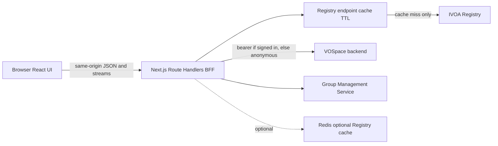
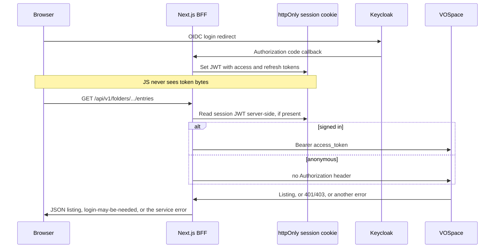

# CANFAR Storage User Interface — Specification

**Version:** 0.15 (draft)  
**Status:** Normative for initial implementation  
**Audience:** Developers implementing **Travorse**, platform operators, and reviewers replacing the sunset Java `storage-ui`.

**Repository:** The application source lives in the **`travorse`** repository (this tree). The earlier path/name `opencadc/user-storage-app` is **obsolete** and must not appear in specifications, Helm values, images, or runbooks.

**Architecture decisions:** Major *why* choices are recorded as ADRs in [docs/adr/README.md](./adr/README.md) (ADR-0001–0008). This document remains the normative *what*; ADRs link back to sections below.

---

## 1. Purpose and scope

### 1.0 Architecture decision records

| ADR | Title |
|-----|--------|
| [0001](./adr/0001-nextjs-bff-direct-vospace.md) | Next.js BFF with direct VOSpace integration |
| [0002](./adr/0002-single-vospace-per-deployment.md) | Single VOSpace per deployment |
| [0003](./adr/0003-file-folder-link-domain-model.md) | File, folder, and link domain model |
| [0004](./adr/0004-oidc-keycloak-only.md) | OIDC via Keycloak only |
| [0005](./adr/0005-authjs-session-no-client-tokens.md) | Auth.js session cookie; no client-side tokens |
| [0006](./adr/0006-registry-cache-memory-and-redis.md) | Registry endpoint cache (memory default; optional Redis) |
| [0007](./adr/0007-multi-group-access-control.md) | Multi-group access control on entries |
| [0008](./adr/0008-align-stack-with-science-portal.md) | Align stack with Science Portal |

### 1.1 Product context

The **Storage User Interface** is a first-class offering in the **CANFAR Science Platform** suite. Researchers use it to browse and manage files and folders on a **single co-located VOSpace service** per deployment, in the same way they use **Science Portal** to manage interactive sessions.

Each deployment instance is paired with **one** VOSpace backend (for example one Cavern or one Vault). Users who need a different storage service open a **different deployment URL** — not an in-app switcher. Platform operators may expose that URL as a dedicated hostname (for example `my-vospace-1.example.com`) or as a path under a shared host (for example `example.com/my-vospace-1`); the exact routing pattern is **deployment-defined** (see §4.6).

Typical entry points:

- The deployment’s public URL (hostname or path prefix + browse route)
- Links from Science Portal or documentation that point at the **correct deployment** for that storage service

The current production UI at [CANFAR storage](https://www.canfar.net/storage/list/) is implemented in OpenCADC [`storage-ui`](https://github.com/opencadc/storage-ui) (Java WAR, jQuery Filemanager, FreeMarker). That application **will be sunset** after this replacement is deployed. This specification defines **Travorse** — a deliberate departure from the Java stack and UX, not a like-for-like port.

### 1.2 Functional goal

Deliver a **filesystem-like browser** backed by **IVOA VOSpace 2.x**, using familiar concepts only:

- **Folders**, **files**, and **links** (see §1.7)
- Create folders, upload and download files, create links, move and delete items
- View and edit **access control** (multiple read groups, multiple read/write groups, public access) where the backend supports it

### 1.3 Users and authentication

- **Primary users:** CANFAR researchers browsing this deployment’s VOSpace. A session is **optional**. Public folders are visible without signing in; other folders are restricted the way a filesystem is.
- **Anonymous access:** The BFF calls VOSpace with no bearer token. The service decides what that caller can see.
- **Signed-in access:** The same calls include the user’s bearer token. Group memberships still control what they can open. A 401 or 403 means a login **may** help, and it may not (§5.2).
- **Operators:** Configure **one** VOSpace service binding, OIDC (Keycloak), Registry, optional Redis (Registry cache), and feature flags via Helm/env (no UI required for v1)

### 1.4 Phased delivery

| Phase | Scope |
|-------|--------|
| **Phase 1 (MVP)** | Single-service deployment config, browse/list with paging, navigation (breadcrumb, **Home** and **Projects** quick-links, up, root), **responsive feedback** for slow listings and uploads, **storage statistics (quota)** in the shell, create folder, upload/download single files, delete, move, rename (where supported), error and empty states |
| **Phase 2** | Access control editor (**multiple** read and read/write groups, public, recursive apply), links (VOSpace and optional external), extended quota context on arbitrary folders, GMS group picker |
| **Phase 3** | Batch ZIP/TAR package download, folder batch upload via download-manager integration (parity with legacy `pkg` / batch connectors) |

Features gated by **feature flags** (see §4) may remain disabled until a later phase but must be represented in config and UI (hidden or disabled, not absent).

### 1.5 Non-goals

- Replacing VOSpace, Registry, or GMS services
- Exposing Registry or VOSpace credentials to the browser
- Java Web Start download manager (legacy; deprecated unless Phase 3 restores an equivalent HTTP API)
- **API or UI compatibility** with the old Java `/storage/*` REST surface (sunset; see §9 for historical reference only)
- **In-app switching** between multiple VOSpace backends (use separate deployments and URLs instead)
- **Legacy SSO cookie** authentication (Keycloak OIDC only; §5.1)

### 1.6 Intentional departures from `storage-ui`

| Topic | Legacy behavior | New application |
|-------|-----------------|-----------------|
| Platform stack | Java WAR, Restlet, jQuery | Next.js BFF + React (§2) |
| User vocabulary | Mixed filesystem and VOSpace “node” language | **Files, folders, links** only in UI and public API (§1.7) |
| Read / read-write groups | UI effectively edited **one** read group and **one** write group per item (`readGroup` / `writeGroup` JSON) | **Multiple groups** per access class; full list round-trips in API (§6.10) |
| Directory listing | CSV for DataTables | JSON `FolderListing` with typed entries |
| Slow operations | Minimal progress for large `/home` listings and uploads | Explicit loading, progress, and status feedback (§7.7) |
| User statistics | Quota sometimes buried in folder popover | Persistent **quota** display when available (§6.12, §7.8) |
| Quick navigation | Home when folder exists | **Home** + **Projects** (`/projects`) quick-links (§7.2) |
| VOSpace backends | One WAR, **multiple backends** via `{svc}` URL and UI dropdown | **One VOSpace per deployment**; other services = other URLs (§4.6) |
| Authentication | SSO domain cookies + optional OIDC | **OIDC only** (Keycloak); no legacy SSO cookies (§5) |
| Long-term maintenance | Continued WAR releases | Java app **sunset**; feature work happens here only |

Other behavior (OIDC, Registry resolution, transfers) remains conceptually similar but is reimplemented in TypeScript against the **single** bound VOSpace service.

### 1.7 Domain model: files, folders, and links

The application presents a **storage abstraction** over VOSpace. Users and client developers MUST NOT see IVOA terms such as **node**, **container**, **data node**, or **link node** in product copy, public JSON field names, or URL segments exposed to the browser.

| User concept | Meaning | Maps to VOSpace (implementer-only) |
|--------------|---------|-----------------------------------|
| **Folder** | Directory that contains files, folders, and links | Container |
| **File** | Byte stream (document, dataset, etc.) | Data |
| **Link** | Pointer to another VOS URI or external URL | Link |

**Path:** A single POSIX-style absolute path string (for example `/home/jdoe/project/data.fits`) identifies an entry within **this deployment’s** VOSpace. The BFF resolves path → VOS URI using the configured `vos://` prefix (`VOSPACE_URI`).

**Discriminated entries:** Every item in a listing or detail response includes `kind: "folder" | "file" | "link"`. Shared fields (name, path, modified, owner, access) apply to all kinds; kind-specific fields (for example `sizeBytes` on files, `target` on links) are documented in §6.

**Internal code:** Server modules may use names such as `vospaceNode` in private TypeScript; that naming MUST NOT leak into HTTP responses or React component props intended for product UI.

**Allocation (product term):** A **top-level folder** — a folder (`Container`) that is a **direct child of Root** when listing path `/`. Allocations are **discovered** from that Root listing (`kind: "folder"`), not hardcoded (typical CANFAR examples: `/home`, `/projects`). Configured paths such as `projectsFolderPath` and per-user `homePath` are **shortcuts** only. Quota properties (§6.12) do **not** define allocations.

---

## 2. Technology stack

### 2.1 Recommended stack (normative for v1)

Align with [**Science Portal**](https://github.com/canfar/science-portal) so the platform shares one operational and developer playbook:

| Layer | Choice |
|-------|--------|
| Framework | **Next.js 15** (App Router) |
| Language | **TypeScript** |
| UI | **React 19**, **MUI 7**, Emotion |
| Styling | Tailwind optional (Science Portal uses Tailwind 4 + MUI) |
| Client data | **TanStack Query** |
| Auth | **NextAuth v5** (OIDC via platform **Keycloak**) |
| Runtime | **Node 20 LTS** |
| Container | `next build` with **`output: 'standalone'`** |
| Tests | **Vitest** (unit/contract); Playwright or equivalent (E2E smoke) |

**Base path:** Support `NEXT_PUBLIC_BASE_PATH` (for example `/storage`), matching Science Portal’s `/science-portal` pattern.

### 2.2 Architecture: BFF in Next.js

The browser talks **only** to the Next.js origin (HTML, static assets, and JSON/streaming API). The **Backend-for-Frontend (BFF)** is implemented as **Next.js Route Handlers** under `/api/…`.

The BFF:

1. When a session exists, obtains a **Bearer access token** for outbound calls. When it does not, calls VOSpace anonymously. The service, not the BFF, decides whether the folder is public.
2. Resolves service **resource IDs** to HTTPS base URLs via the **IVOA Registry**, through a **TTL cache** (§3)
3. Maps the file/folder/link model to VOSpace protocol operations (server-side only) and performs transfers and (optionally) GMS calls on behalf of the user



**Rationale:** Same pattern as Science Portal (server-side API routes, no CORS to platform services, secrets stay on server). VOSpace XML/transfer complexity stays in TypeScript modules invoked by Route Handlers, not in the browser.

### 2.3 Alternatives considered (informative)

| Alternative | Why not v1 default |
|-------------|-------------------|
| Vite SPA + separate Fastify/Hono service | Splits deployment, auth, and Helm patterns; duplicates Science Portal lessons |
| Next.js UI + legacy Java `/storage/*` API | Conflicts with direct VOSpace BFF decision |
| Modern JS bundle inside Java WAR | Perpetuates Tomcat/Restlet stack |

**Escape hatch:** If Phase 3 batch packaging or sustained multi‑GB proxying exceeds comfortable limits for a single Node process, add a **small transfer sidecar** (same ingress, shared session validation) without changing the primary Next.js application.

### 2.4 Future platform evolution (non-blocking)

Extract shared npm packages (for example `@canfar/registry-resolver`, `@canfar/vospace-client`) consumed by Science Portal and Storage UI. Not required for v1.

---

## 3. Registry resolution and caching

### 3.1 Requirement

**Browser-driven actions must not cause a Registry HTTP request on every operation.** Listing a folder, refreshing the table, or downloading a file reuses **cached** endpoint URLs until TTL expiry or explicit invalidation.

This mirrors Java `RegistryClient.getServiceURL(resourceID, standardURI, authMethod)` used throughout legacy `storage-ui`.

### 3.2 Cache key and value

**Key:**

```
(resourceID, standardURI, authMethod) → string
```

- `resourceID`: IVOA identifier (for example `ivo://cadc.nrc.ca/arc`)
- `standardURI`: capability standard (see §8.2)
- `authMethod`: **`TOKEN`** (Bearer) for Registry and VOSpace endpoint resolution — matches OIDC-only outbound auth

**Value:**

```typescript
interface CachedServiceEndpoint {
  url: string;           // HTTPS base URL (no trailing slash normalization documented in code)
  resolvedAt: number;    // epoch ms
  expiresAt: number;     // epoch ms
}
```

### 3.3 Lookup order

1. **Process-local LRU** (required)
2. **Redis** (optional, recommended for multi-replica deployments so new pods do not each cold-hit Registry)
3. **Registry HTTP** on miss; store in (1) and (2) with TTL

### 3.4 Configuration

| Variable | Description | Default (suggested) |
|----------|-------------|---------------------|
| `REGISTRY_CACHE_TTL_SECONDS` | TTL for resolved endpoints | `1800` (30 minutes) |
| `REGISTRY_CACHE_MAX_ENTRIES` | LRU cap per process | `500` |
| `REGISTRY_URLS` | Comma-separated Registry base URLs (Java `RegistryClient.baseURL` list); tried in order | deployment-specific |
| `REGISTRY_CONNECTION_TIMEOUT_MS` | Abort if the Registry HTTP response has not **started** within this time (connect + headers) | `3000` |
| `REGISTRY_READ_TIMEOUT_MS` | Abort if the response **body** is not fully read within this time after the response starts (property maps) | `6000` |
| `REGISTRY_MAX_RETRIES` | Retries per Registry base URL before trying the next URL | `1` |
| `REGISTRY_CACHE_REDIS_URL` | Optional shared Registry cache (see §3.8) | **unset / empty = disabled (default)** |
| `REGISTRY_STALE_ON_ERROR` | Serve stale entry if Registry fails | `true` |

### 3.8 Redis — deployer configuration (Registry only)

Redis is **optional** and **deployer-configurable**. It is **not** used for OIDC access or refresh tokens in v1 (§5.1.1).

| Deployer choice | Configuration | Registry cache behavior | OIDC tokens |
|-----------------|---------------|-------------------------|-------------|
| **Disabled (default)** | Omit `REGISTRY_CACHE_REDIS_URL` or set it empty | Each pod uses **process-local LRU** only (§3.3 step 1 → 3). Slightly more Registry traffic on cold pods or after restarts. | **Unchanged:** always in **httpOnly Auth.js session cookie** |
| **Enabled** | Set `REGISTRY_CACHE_REDIS_URL` (for example `redis://…`) | Pods share cached Registry endpoints in Redis (§3.3 steps 1 → 2 → 3). Recommended when **`replicaCount > 1`** to avoid every pod cold-missing Registry. | **Still cookie only** — Redis does not hold user tokens |

Helm should expose this as an optional value (subchart, external URL, or disabled by default). **Enabling Redis does not change authentication storage.** **Disabling Redis does not move tokens into Redis or out of the cookie** — tokens are in the session cookie in both cases.

Legacy sunset `storage-ui` used Redis for **token** lookup (`org.opencadc.vosui.tokenCache.url`). That pattern is **not** used here.

### 3.5 Invalidation

- Automatic: TTL expiry
- Config change: process restart or admin refresh (below)
- Optional: `POST /api/admin/registry/refresh` — **authenticated ops role only**; clears cache keys or flushes Redis namespace

### 3.6 Normative rule for implementers

All Route Handlers and server modules call **`getCachedServiceUrl(resourceId, standard, authMethod)`** — never the Registry client directly except inside the cache module. Unit tests must assert **zero Registry HTTP calls** when invoking the same handler twice within TTL.

The low-level Registry HTTP client is **`RegistryClient`** in `src/lib/registry/` (mirrors Java [`RegistryClient`](https://github.com/opencadc/reg/blob/main/cadc-registry/src/main/java/ca/nrc/cadc/reg/client/RegistryClient.java): fetch `{baseURL}/resource-caps` or `/applications` property maps with TTL cache, resolve capabilities documents, then `getServiceURL(resourceId, standardId)`).

### 3.7 GMS group list (separate cache)

`GET /api/v1/groups` may use a **shorter TTL** (for example 5–15 minutes) or session-scoped cache, independent of VOSpace endpoint cache. Still **server-side only**.

---

## 4. Configuration model

Configuration is **server-only** (env vars and/or mounted config file). The browser receives a sanitized subset via `GET /api/v1/config`.

Each running instance binds to **exactly one** VOSpace service. There is no list of backends, no default-service selection, and no `service` query parameter on API routes.

### 4.1 VOSpace binding (single service)

| Setting | Description |
|---------|-------------|
| `VOSPACE_URI` | `vos://` prefix for this deployment (for example `vos://cadc.nrc.ca~arc`). The Registry resource ID is derived from the authority: `~` and `!` become `/`, so that prefix is `ivo://cadc.nrc.ca/arc`. This is the only VOSpace service binding. |
| `VOSPACE_USER_HOME_DIR` | Base path for home folders (for example `/home`) |
| `VOSPACE_PROJECTS_FOLDER_PATH` | Quick-link to shared projects tree (default `/projects`) |
| `GMS_RESOURCE_ID` | Group Management service for permission UI |
| `GROUP_MANAGEMENT_URI` | Optional link to external group admin UI |

**Feature flags** for this VOSpace implementation:

```typescript
interface VospaceFeatures {
  externalLinks: boolean;
  paging: boolean;
}
```

Batch folder download (VOSpace package / sync) and multi-file upload are **product capabilities** (Phase 3 packages, HTTP multipart upload)—not legacy `storage-ui` batch feature toggles.

UI and BFF must respect flags: do not call unsupported VOSpace query parameters (for example `limit` / `uri` when `paging: false`). Paging support is **operator-configured** until IVOA Registry / VOSI advertises container listing paging per service.

| Helm / env | Feature flag |
|------------|----------------|
| `application.vospace.features.paging` / `VOSPACE_FEATURE_PAGING` | When `false`, BFF omits VOSpace `limit` and `uri`; UI omits `pageSize` and `startUri`. When `true`, use Vault-style **`uri`** (not `startURI`) as the VOSpace continuation query param; public BFF keeps **`startUri`** / **`nextStartUri`**. The UI exposes **user-chosen page size** (default **50**, presets up to **500**); the same size is sent on every page including “Load more”. |

### 4.2 Legacy property mapping (informative)

Sunset `storage-ui` allowed **multiple** named services in `org.opencadc.vosui.properties`. The new app uses **one** block per deployment — pick the entries that applied to **one** `{name}` and drop `service.default` / repeated `service.name`:

| Legacy (single `{name}`) | New env / config |
|--------------------------|------------------|
| `org.opencadc.vosui.{name}.service.resourceid` | Derived from `VOSPACE_URI` (`ivo://` resource ID) |
| `org.opencadc.vosui.{name}.node.resourceid` | `VOSPACE_URI` |
| `org.opencadc.vosui.{name}.user.home` | `VOSPACE_USER_HOME_DIR` |
| `org.opencadc.vosui.{name}.service.features.*` | `VOSPACE_FEATURES_*` or structured JSON |
| `org.opencadc.vosui.gms.service_id` | `GMS_RESOURCE_ID` |
| OIDC | NextAuth v5 + Keycloak (§5.1); `AUTH_SECRET`, client id/secret — same model as Science Portal |

Deploy **separate Helm releases** (or containers) per VOSpace backend, each with its own env.

### 4.3 Example Helm values (one deployment)

Chart-specific settings live under top-level **`application`** (mapped to container env by `helm/templates/_env.tpl`):

```yaml
application:
  publicUrl: "https://storage.canfar.net"
  basePath: ""
  auth:
    issuer: "https://keycloak.example.com/realms/canfar"
    clientId: "travorse"
    scope: "openid profile email offline_access"
    trustHost: true
    authSecret:
      existingSecret: "travorse-secrets"
      secretKey: auth-secret
    clientSecret:
      existingSecret: "travorse-secrets"
      secretKey: oidc-client-secret
  registry:
    urls:
      - "https://cadc-west-01.canfar.net/reg"
    cacheTtlSeconds: 1800
  vospace:
    # vos://cadc.nrc.ca~arc → Registry resource ivo://cadc.nrc.ca/arc
    uri: "vos://cadc.nrc.ca~arc"
    userHomeDir: "/home"
    projectsFolderPath: "/projects"
    groupManagementUri: "https://www.cadc-ccda.hia-iha.nrc-cnrc.gc.ca/en/groups"
    features:
      externalLinks: false
      paging: true
gmsResourceId: "ivo://cadc.nrc.ca/gms"
```

A second backend (for example Vault) is a **second chart instance** with a different `vospace.uri` and its own ingress URL — not a second entry in the same UI.

### 4.4 Public config API response

`GET /api/v1/config` returns (no secrets):

```typescript
interface PublicConfig {
  /** Human-readable label for this deployment (optional; for header/branding, not backend switching). */
  deploymentLabel?: string;
  /** Optional logo image URL (HTTPS/HTTP); loaded by the browser in the app bar. */
  logoUrl?: string;
  /** Configured `vos://` prefix (`VOSPACE_URI`). */
  nodeUriPrefix: string;
  userHomeDir: string;
  projectsFolderPath: string;
  groupManagementUri?: string;
  features: VospaceFeatures;
  /** Next.js `basePath` when using path-based deployment (§4.6). */
  basePath: string;
  /** Set when using dedicated hostname branding (optional). */
  publicOrigin?: string;
}
```

Branding env (Helm `application.branding`): `BRANDING_LOGO_URL`, `DEPLOYMENT_LABEL`. The logo link targets the **application** browse home (`/browse` + `basePath`), not the user’s VOSpace home folder.

**Must not** trigger Registry lookups. **Must not** expose a list of alternate VOSpace backends.

### 4.5 Session navigation — `GET /api/v1/session/navigation`

Returns **per-user** quick-link targets for **this deployment** after authentication. Called once per session (cache in TanStack Query).

```typescript
interface SessionNavigation {
  homePath: string | null;
  projectsPath: string;
}
```

**`homePath` resolution (normative):** When `userHomeDir` is configured (for example `/home`), compute `{userHomeDir}/{username}` using the authenticated user's canonical username/display identity (same rule as legacy `MainPageServerResource`). Perform a lightweight existence check against VOSpace (minimal detail). If the folder does not exist or the user is anonymous, return `homePath: null`. The UI **must not** show an enabled Home quick-link when `homePath` is null.

No query parameters required.

### 4.6 Deployment URL and co-location

The application is **co-located** with its VOSpace service in the operational sense: one deployment, one Registry `resourceID`, one set of feature flags. Users discover other storage systems by **navigating to another URL**, not from a dropdown in this UI.

Platform routing is **not fully prescribed** here; implementations MUST support:

| Pattern | Description | Configuration |
|---------|-------------|---------------|
| **Dedicated hostname** | UI and API at `https://my-vospace-1.example.com/` | Ingress host rule; `basePath` often `""` |
| **Shared host, path prefix** | UI at `https://example.com/my-vospace-1/…` | `NEXT_PUBLIC_BASE_PATH=/my-vospace-1` (align with Science Portal pattern) |

Requirements:

- OIDC redirect URIs MUST match the chosen public URL pattern for **each** deployment instance.
- Science Portal (or other suite UIs) link to storage using the **deployment-specific** URL configured for that environment — not a shared `/storage` URL with an internal service name.
- The browse route and BFF live under the same origin as the UI for that instance (same host + base path).

Document the chosen pattern per environment in operator runbooks; the application code assumes a single origin per process, not dynamic backend selection.

---

## 5. Authentication and authorization

### 5.1 OIDC via Keycloak (required)

The CANFAR Science Platform is moving from **legacy SSO cookies** to **Keycloak** as the identity provider with standard **OpenID Connect**. This application is intended to ship **after** that transition; it **does not** implement legacy SSO cookie authentication (no `SSOCookieCredential`, no cookie re-targeting to VOSpace hosts as in sunset `storage-ui`).

**Align with [Science Portal](https://github.com/canfar/science-portal) OIDC mode** (`NEXT_USE_CANFAR=false`):

- **NextAuth v5** (Auth.js) with Keycloak as the OIDC provider
- Client ID and secret **server-only**
- Redirect/callback URLs registered in Keycloak for **each** deployment URL pattern (§4.6)
- Scopes and audience as required by CANFAR platform policy
- **`AUTH_SECRET`** (or equivalent) for signing/encrypting session material

**BFF-only upstream auth:** Browser code calls **same-origin** `/api/…` routes only. It **must not** attach `Authorization: Bearer` from JavaScript (see Science Portal `getAuthHeader()` in OIDC mode). When a session exists, Route Handlers obtain credentials via **`await auth()`** on the server and forward the Bearer token to VOSpace/GMS. When it does not, VOSpace is called with no `Authorization` header.

**Outbound calls:** VOSpace and GMS HTTP requests use **`Authorization: Bearer <access_token>`** only when the caller has a session. Anonymous requests omit that header. Registry lookups for service URLs stay anonymous.

**Non-goals:** Legacy SSO cookies, `localStorage` / `sessionStorage` tokens, dual auth modes, or certificate-only browser flows in v1. **Not** the sunset Java pattern of Redis lookup cookies unless explicitly revisited later.

### 5.1.1 Where tokens are stored (Science Portal–consistent)

Tokens are **never stored in client-side storage** (`localStorage`, `sessionStorage`, or readable client state). They are **not** exposed on the JSON returned to the browser from `/api/auth/session` (this is stricter than current Science Portal, which copies `accessToken` into the client session object — Storage UI **must not**).

| Location | What is stored | Who can read it |
|----------|----------------|-----------------|
| **Browser httpOnly session cookie** | NextAuth **encrypted/signed JWT** (session strategy) containing OIDC **access token**, **refresh token**, expiry, and user claims | Browser sends cookie automatically; **JavaScript cannot read** the cookie or its payload |
| **Next.js server (per request)** | Decoded session from `auth()` in memory for the lifetime of the request | Server only |
| **Client React / TanStack Query** | User profile fields only (name, email, etc.) — **no** access or refresh tokens | Browser JS |



**Refresh:** Access token renewal runs in the NextAuth **`jwt` callback** on the server (same pattern as Science Portal `auth.ts`). Updated tokens are written back into a **new session cookie**; the client still never receives raw tokens.

**Multi-replica deployments:** Follow Science Portal operational guidance: concurrent refresh against Keycloak must be serialized or **sticky sessions** on the Auth.js session cookie at the ingress load balancer, so refresh-token rotation does not race across pods. Document stickiness in the Helm/runbook for `replicaCount > 1`.

**Redis and tokens (summary):** Redis is optional for **Registry URL caching** only (§3.8). With Redis **disabled** (the expected default), OIDC **access and refresh tokens remain inside the httpOnly session cookie** — that is the normal and required auth storage for v1. Redis off does **not** imply a different token store.

### 5.2 Authorization semantics

Authentication is **optional**. VOSpace is the access check, in the same way a filesystem allows wandering through some directories and refuses others.

- The BFF does **not** reject a listing because the browser has no session. It forwards the call and returns what VOSpace returns.
- **401 or 403 from VOSpace:** Tell the user that a login **may** be needed. Say that signing in may still not grant access when their group memberships do not allow it. Do not treat this as “you must sign in” and do not redirect automatically.
- **Any other error:** Report the service message as returned (status and text). Do not replace it with a generic summary.
- Never leak tokens or session secrets in error bodies or client session JSON.

### 5.3 CSRF and mutating requests

Mutating Route Handlers (`PUT`, `POST`, `PATCH`, `DELETE`) must validate CSRF (NextAuth double-submit cookie or equivalent).

---

## 6. BFF API (v1)

**Prefix:** `/api/v1`  
All routes target the **VOSpace service configured for this deployment**. There is no `service` query parameter.

Path parameters below use `:path` as URL-encoded VOSpace path segments (for example `/home/user/docs`). Use a consistent encoding rules document in implementation (leading slash, no `..` segments).

### 6.1 Summary table

Public routes use **folder**, **file**, **link**, or neutral **entries** — never `node`.

| Method | Path | Phase | Description |
|--------|------|-------|-------------|
| GET | `/api/v1/config` | 1 | Public UI configuration |
| GET | `/api/v1/session/navigation` | 1 | Home and Projects paths for signed-in user |
| GET | `/api/v1/folders/{path...}/entries` | 1 | List contents of a folder |
| GET | `/api/v1/folders/{path...}/statistics` | 1 | Storage statistics (quota) for context folder |
| GET | `/api/v1/entries/{path...}` | 1 | Metadata for a file, folder, or link |
| PUT | `/api/v1/folders/{path...}` | 1 | Create folder at `{path}` |
| DELETE | `/api/v1/entries/{path...}` | 1 | Delete file, link, or folder (recursive job if folder non-empty) |
| POST | `/api/v1/folders/{path...}/files` | 1 | Multipart upload into folder |
| GET | `/api/v1/files/{path...}` | 1 | Download file (303 to VOSpace) |
| POST | `/api/v1/transfers/move` | 1 | Move files/folders/links via VOSpace transfer |
| PATCH | `/api/v1/entries/{path...}/access` | 2 | Update access control (multi-group) |
| GET | `/api/v1/folders/{path...}/quota` | 2 | *(Deprecated by `/statistics`; optional alias)* |
| GET | `/api/v1/groups` | 2 | Group names for access-control UI |
| PUT | `/api/v1/links/{path...}` | 2 | Create or update link |
| POST | `/api/v1/packages` | 3 | Batch download package |
| GET | `/api/auth/login` | 1 | Start OIDC flow |
| GET | `/api/auth/callback` | 1 | OIDC callback |
| POST | `/api/auth/logout` | 1 | End session |
| GET | `/api/health` | 1 | **Liveness** — process is running |
| GET | `/api/ready` | 1 | **Readiness** — configured to accept traffic |
| GET | `/api/version` | 1 | Application name and version (public) |

Operational routes are **unauthenticated** (no session required). They must not expose secrets.

### 6.2 List folder contents — `GET /api/v1/folders/{path...}/entries`

Lists **files, folders, and links** directly inside the folder at `{path}`. For the storage root, use path `/`.

**Authentication:** Not required. Anonymous callers see what VOSpace exposes publicly. A signed-in caller’s bearer token is forwarded when a session exists. VOSpace **401** and **403** use the login-may-be-needed message in §5.2. Other failures pass through the service error.

**Query:**

| Param | Required | Description |
|-------|----------|-------------|
| `pageSize` | No | Max entries per page when `features.paging` (default **50**, max **500** if omitted on the BFF) |
| `startUri` | No | Cursor for next page (internal VOS URI; opaque to UI copy) |

**Response:** `FolderListing`

```typescript
interface FolderListing {
  folderPath: string;
  parentPath: string | null;
  canWrite: boolean;       // current user can add/rename/delete in this folder
  canRead: boolean;
  entries: StorageEntry[];
  nextStartUri?: string;
  totalCount?: number;
}
```

**Registry:** Uses cached VOSpace nodes capability only — no Registry call per request (§3).

### 6.3 Storage entries — `StorageEntry`

Discriminated union; every entry includes access control as **arrays** (zero or more group display names):

```typescript
interface EntryBase {
  kind: "folder" | "file" | "link";
  name: string;
  path: string;
  uri: string;                 // vos:// URI; for debugging/support, not primary UI label
  modified: string;            // ISO-8601 UTC
  modifiedDisplay: string;
  owner: string;
  canRead: boolean;
  canWrite: boolean;
  locked: boolean;
  isPublic: boolean;
  readGroups: string[];        // all groups with read access
  writeGroups: string[];       // all groups with read/write access
  icon: string;                // semantic icon key for UI
}

interface FolderEntry extends EntryBase {
  kind: "folder";
}

interface FileEntry extends EntryBase {
  kind: "file";
  sizeBytes: number;
  sizeDisplay: string;
}

interface LinkEntry extends EntryBase {
  kind: "link";
  target: string;              // target URI or URL
  navigatePath?: string;       // if target is in-space, path for UI navigation
}

type StorageEntry = FolderEntry | FileEntry | LinkEntry;
```

### 6.4 Entry detail — `GET /api/v1/entries/{path...}`

Returns one `StorageEntry`. For `kind: "folder"`, may include `childCount` when inexpensive to compute.

### 6.5 Create folder — `PUT /api/v1/folders/{path...}`

Creates a **folder** at `{path}`. Returns `201` with `FolderEntry`. `409` if an entry already exists at that path with a different kind.

### 6.6 Delete — `DELETE /api/v1/entries/{path...}`

Applies to any `kind`:

- File or link: synchronous delete (`204`)
- Empty folder: synchronous delete (`204`)
- Non-empty folder: recursive delete job (`202 Accepted` with optional job reference)

### 6.7 Upload — `POST /api/v1/folders/{folderPath...}/files`

**Content-Type:** `multipart/form-data`

| Field | Description |
|-------|-------------|
| `file` | File bytes (repeatable for multi-file if UI supports) |
| `relativePath` | Optional path under folder (file name if omitted) |
| `inheritAccess` | Optional boolean — copy folder access to new file |

Uses VOSpace transfer push into `{folderPath}`.

**Limits:** Configurable max body size at reverse proxy and Route Handler; return `413` when exceeded.

### 6.8 Download — `GET /api/v1/files/{path...}/content`

Only valid when `{path}` identifies a **file**. Wrong kind → `404` or `409` with clear error.

Always respond **`303 See Other`** to an ultimate download URL (no byte proxy through the BFF). **Signed-in:** negotiate via **sync-2.1** (`POST` transfer, then **`GET` job URL with bearer** and follow sync/UWS redirects on the server, as Java `HttpGet` does); the BFF **`Location`** is the final **pre-auth** HTTPS GET URL from transfer XML or a non-negotiation redirect — never a UWS job URL the browser would call without credentials. **Anonymous:** **`303`** to Registry **Files** URL + path (not pre-authorized). The UI opens the BFF download URL in a hidden iframe so the browser follows redirects to VOSpace (avoid `fetch` + `redirect: manual`, which is opaque for cross-origin `Location`).

Registry: **`VOSPACE_SYNC_21`** for negotiation; **`VOSPACE_FILES`** / **`VOSPACE_FILES_20`** for anonymous redirect.

#### 6.8.1 Scope and configuration

| Item | Behavior |
|------|----------|
| **Routes** | `{contextPath}/file{path}` or `{contextPath}/{svc}/file{path}` → `FileItemServerResource` (`StorageApplication`) |
| **`directDownload`** | Loaded into `VOSpaceServiceConfig.Features.supportsDirectDownload` via `VOSpaceServiceConfigManager`. **Not read anywhere in `FileItemServerResource`.** |
| **Effect of flag on this GET** | None. Single-file GET **always** ends in an HTTP redirect to a VOSpace Files / transfer URL; the UI never proxies the bytes through this resource. (`supportsDirectDownload()` only gates redirect vs proxy in `PostAction` for package/synctrans downloads.) |

##### Request lifecycle

###### 1. Init (`StorageItemServerResource.doInit`)

- Resolve `currentService` from `{svc}` (or default).
- Construct `VOSpaceClient` for that service’s registry resource ID.
- Initialize `StorageItemFactory`.

###### 2. Entry — `@Get download()`

- `path ← getCurrentPath()` from route attribute `path` (default `/`).
- `dataNode ← getNode(path, null, null)`:
  - `voSpaceClient.getNode(path, "")` under `executeSecurely(getVOSpaceCallingSubject())`.
  - Augment node with parent paths; map auth/registry failures to `ResourceException` / `NotAuthenticatedException` as implemented in `getNode`.

###### 3. Download — `download(dataNode)`

- `subject ← getVOSpaceCallingSubject()` (`SecureServerResource.getCallingSubject` on VOSpace base URL; may attach OIDC bearer token → `AuthMethod.TOKEN`).
- `dataNodeVOSURI ← toURI(dataNode)` → `{nodeResourceID}{path}`.
- `authMethod ← AuthenticationUtil.getAuthMethodFromCredentials(subject)`.
- `baseURL ← lookupDownloadEndpoint(serviceURI, authMethod)`:
  - Registry lookup, in order: `Standards.VOSPACE_FILES`, then `Standards.VOSPACE_FILES_20`.
  - If neither resolves → `IllegalStateException` (“Incomplete configuration in the registry…”).

###### 4. Redirect target (303 See Other via `redirectSeeOther`)

| Condition | `Location` |
|-----------|------------|
| `authMethod == TOKEN` **and** subject has **no** `AuthorizationToken` credentials | `baseURL + dataNodeVOSURI.getPath()` |
| `authMethod == TOKEN` **and** subject **has** token(s) | `toEndpoint(dataNodeVOSURI.getURI())` — `voSpaceClient.createTransfer(pullFromVoSpace, default view, `HTTPS_GET`, VOSpace 2.1) → transfer endpoint URL |
| Any other auth method (ANON, CERT, COOKIE, …) | `baseURL + dataNodeVOSURI.getPath()` |

###### 5. Outcome

- **Success:** HTTP redirect; client fetches file **directly** from the backend Files/transfer URL (no streaming through storage-ui).
- **Failure:** Exceptions from node lookup, registry, or transfer creation propagate as Restlet/resource errors (no proxy fallback on this path).

##### Non-goals on this path

- No request-body handling (POST/PUT upload path is separate).

### 6.9 Move — `POST /api/v1/transfers/move`

**Body:**

```json
{
  "srcPaths": ["/home/user/a.txt", "/home/user/b"],
  "destFolderPath": "/home/user/archive"
}
```

Moves files, folders, or links into the destination folder via VOSpace transfer with **`keepBytes: false`**.

### 6.10 Access control — `PATCH /api/v1/entries/{path...}/access` (Phase 2)

Updates access for a **file, folder, or link**. Replaces the full access picture for categories present in the body (not a partial merge of group lists unless documented otherwise in implementation).

**Body:**

```json
{
  "isPublic": false,
  "readGroups": ["CADC staff", "project-reviewers"],
  "writeGroups": ["my-project-writers", "my-project-admins"],
  "applyRecursively": false
}
```

| Field | Semantics |
|-------|-----------|
| `readGroups` | Ordered list of group **display names** with read access; `[]` clears all read groups |
| `writeGroups` | Ordered list with read/write access; `[]` clears all write groups |
| `isPublic` | World-readable when true |
| `applyRecursively` | When true and entry is a folder, run recursive access update job |

**Response:**

- `200` — synchronous update on this entry
- `202` — recursive job accepted

**BFF mapping:** Translate to VOSpace read-only and read-write group collections on the underlying resource (full replace of each collection). This is a **product improvement** over the old Java UI, which exposed only single `readGroup` / `writeGroup` fields in its JSON API even when the backend held multiple groups.

**UI (Phase 2):** Multi-select (or chip input) for read groups and for write groups; show all groups in the folder listing columns (truncated with expand/tooltip when many).

### 6.11 Access in listings and detail

`readGroups` and `writeGroups` on every `StorageEntry` are authoritative for display. No separate single-group `/access` endpoint is required unless needed for optimistic UI refresh; prefer `GET /api/v1/entries/{path...}`.

### 6.12 Storage statistics — `GET /api/v1/folders/{path...}/statistics` (Phase 1)

**User statistics** (v1 scope: **quota only**) describe storage allowance for the folder tree context. The UI treats this as first-class information, not an advanced detail.

**Response when quota is reported:**

```typescript
interface StorageStatistics {
  /** Always "quota" in v1; extensible for future metrics. */
  kind: "quota";
  /** Folder path the statistics were resolved against (may be ancestor of requested path). */
  resolvedAgainstPath: string;
  quotaBytes: number | null;
  usedBytes: number | null;
  remainingBytes: number | null;
  /** Human-readable counterparts for display */
  quotaDisplay: string;
  usedDisplay: string;
  remainingDisplay: string;
  /** 0–100 when computable; drives progress bar */
  usedPercent: number | null;
}
```

**When quota is not reported:**

```json
{
  "kind": "none",
  "message": "Storage quota is not available for this location."
}
```

**Resolution:** Walk from `{path}` toward root until a folder carries the VOSpace quota property (same algorithm as legacy `FolderItemServerResource.retrieveQuota`). Prefer resolving against the user's **home folder** when the UI requests statistics from the shell (see §7.8).

**Caching:** Client may cache statistics briefly (for example 60s); refetch after upload completes or when user hits Refresh.

### 6.13 Groups — `GET /api/v1/groups` (Phase 2)

**Response:** JSON array of group name strings, sorted.

Returns group **display names** the signed-in user may use when editing access control — typically Keycloak/OIDC **group memberships** exposed via GMS or a platform group API (same intent as legacy `IvoaGroupClient.getMemberships` under OIDC). Sorted alphabetically.

Resolve GMS via `GMS_RESOURCE_ID` and standard **`GMS_SEARCH_10`** (cached Registry lookup), authenticated with the user’s Bearer token.

### 6.14 Packages — `POST /api/v1/packages` (Phase 3)

**Body:**

```json
{
  "paths": ["/home/user/dir/file1.fits", "/home/user/dir/file2.fits"],
  "format": "package-zip"
}
```

Formats: `package-zip`, `package-tar` (legacy batch download). Uses VOSpace sync/transfer standards (`VOSPACE_SYNC_21` in legacy `PostAction`).

### 6.15 Error envelope

```typescript
interface ApiError {
  error: string;          // stable code, e.g. "NOT_FOUND"
  message: string;        // human-readable
  details?: unknown;      // optional, not for production secrets
}
```

Map VOSpace HTTP/XML errors to appropriate status codes.

### 6.16 Health, readiness, and version

Kubernetes and load balancers need distinct **liveness** vs **readiness** probes. Version information helps operators and users confirm which build is deployed.

#### Version identity

The reported version is **not** a runtime configuration value. It is the `version` field from **`package.json`**, compiled into the running application at **build time** (the same semver as the deployed artifact). Release processes should bump `package.json` when cutting a release; operators must not override version via environment variables.

All health/readiness/version responses include the same **`VersionInfo`** object:

```typescript
interface VersionInfo {
  name: "travorse";
  version: string;
}
```

#### `GET /api/health` — liveness

- **Purpose:** Process is up; Node event loop responding.
- **Must not** call Registry, VOSpace, Keycloak, or Redis (keep probes fast and reliable).
- **Status:** `200 OK`
- **Body:**

```json
{
  "status": "ok",
  "version": { "name": "travorse", "version": "0.1.0" }
}
```

Use for Kubernetes **livenessProbe**.

#### `GET /api/ready` — readiness

- **Purpose:** Instance is configured and safe to receive traffic (OIDC env present and parseable; required VOSpace binding present when storage routes are enabled).
- **Must not** require successful Keycloak or Registry HTTP on every probe (avoid probe storms and external dependency flapping). Optional one-time startup validation is acceptable.
- **Status:** `200 OK` when ready; **`503 Service Unavailable`** when required configuration is missing or invalid.
- **Body (ready):**

```json
{
  "status": "ready",
  "version": { "name": "travorse", "version": "0.1.0" },
  "checks": {
    "oidcConfig": "ok",
    "vospaceConfig": "ok"
  }
}
```

- **Body (not ready):** same shape with `"status": "not_ready"`, `checks` entries `"failed"`, and a non-sensitive `message` (for example `"OIDC_ISSUER not configured"`).

Use for Kubernetes **readinessProbe** and load balancer health checks.

#### `GET /api/version` — public version

- **Purpose:** Operators, support staff, and the **browser footer** fetch the current deployment version without parsing health probes.
- **Status:** `200 OK`
- **Body:** `VersionInfo` (optionally include `status: "ok"` wrapper).

Paths are under `/api/…` so they work with `NEXT_PUBLIC_BASE_PATH` the same way as other API routes (full URL `{origin}{basePath}/api/health`).

#### Browser display (recommended)

Show **`version`** as **small, muted text fixed at the bottom-left** of the viewport on all pages, loaded from **`GET /api/version`** after first paint (do not block initial render).

---

## 7. Frontend (Next.js App Router)

### 7.1 Routes

| Route | Purpose |
|-------|---------|
| `/` | Redirect to browse root for this deployment |
| `/browse/[[...path]]` | Main file browser (deep-linkable); lives under `basePath` when set (§4.6) |
| `/login`, auth callbacks | NextAuth routes |

Encode `path` segments in the URL consistently with the BFF `path` query/body.

### 7.2 Layout and components

- **Shell:** MUI layout, light/dark theme (Science Portal parity); **full-width** browse surface (not a narrow centered column)
- **Version footer:** Bottom-left muted text showing deployed version (§6.16); from `/api/version`
- **Top bar:** Optional **deployment label** (read-only branding from config, not a backend switcher), **quick-links** (see below), login/user menu, link to Science Portal optional via config
- **Left navigation rail (collapsible on small viewports):**
  - **Allocations:** folder children of Root from `GET /api/v1/folders/entries` at `/` (see §1.7 allocation definition); empty state when none are visible
  - **Folder tree:** lazy **caret** expansion under each allocation; **folders only** in the rail; selection syncs with URL `/browse/…`
  - **Storage statistics (quota)** strip at bottom of rail when §7.8 data is available (independent of allocation detection)
- **Quick-links (Phase 1):** Toolbar or top bar — convenience jumps layered on allocations, not a second source of truth for top-level folders
  - **Home** — navigates to `session.navigation.homePath` when non-null; **hidden or disabled** when the user has no home folder (do not link to a non-existent path)
  - **Projects** — navigates to `session.navigation.projectsPath` (default **`/projects`**, overridable in deployment config)
  - Icons + text labels; keyboard accessible; reflect active state when the current browse path equals or is under the link target
- **Navigation bar (main column):** Search/filter by name, Up, Root, Home/Projects quick-links — wayfinding only, not file operations
- **Action bar (main column, above listing):** Primary **Upload** and **Download**; **New folder** / Add menu; **Move** and **Delete** when items are selected and folder is writable (spec §7.4). Sticky on desktop optional. Left rail remains navigation-only.
- **App bar:** Global **upload progress** summary while transfers run (§7.7), not the primary Upload entry point
- **Main view:** Breadcrumb (accessibility + deep links), then data table (default) with columns: name, size, modified (UTC), read/write groups, owner; optional grid view later
- **Side panel (optional Phase 2):** Details, **access control** editor (multi-group) — **right** side; do not conflate with the left allocation rail
- **Copy:** Use “folder”, “file”, “link”, “access”, “read groups”, “read/write groups”, “allocation” where helpful — never “node”

### 7.3 Client state

- **TanStack Query** for `FolderListing`, entry detail, `SessionNavigation`, and `StorageStatistics`; stale-time tuned for UX (separate from Registry TTL)
- Optimistic updates only for low-risk actions with rollback on failure
- Upload progress via XMLHttpRequest/fetch upload events or dedicated upload library (see §7.7)

### 7.4 Feature gating

Disable or hide actions when:

- Current folder `canWrite: false`
- Service feature flag false
- Phase not implemented (show “coming soon” only in dev builds; hidden in production)

### 7.5 Accessibility

- Sortable table headers (keyboard operable)
- Focus management in dialogs (delete confirm, permissions)
- ARIA labels on icon-only toolbar buttons

### 7.6 CANFAR branding

The product uses a **fixed** visual design (MUI shell, system light/dark). Per-deployment differentiation is via **`logoUrl`** and **`deploymentLabel`** (§4.4), not a theme switcher. Optional multi-theme support may be added later if requested.

### 7.7 User feedback and perceived performance (normative)

Operations can take **tens of seconds or longer** (large `/home` listings, multi-GB uploads). The UI must keep users informed and avoid silent failure. This is a **first-class** requirement, not polish.

#### Folder listing (including large folders)

| Situation | Required UX |
|-----------|-------------|
| Initial navigation | Skeleton rows or table placeholder; message such as “Loading folder contents…” |
| Request exceeds ~2s | Inline notice: “This folder may be large; still loading…” (do not block the rest of the shell) |
| Paged results (`nextStartUri`) | **Items per page** control when paging is enabled (default 50); show partial results immediately; **“Load more”** with spinner at bottom; display loaded count (for example “Showing 50 (more in this folder)”) |
| Initial load &gt; ~2s | Inline “may be large; still loading…” (including **first** navigation, not only background refetch) |
| Name filter with more pages | Hint that filter applies to **loaded** items only |
| `features.paging: false` | Info banner: full listings may take minutes on very large folders |
| Background refetch | Keep previous listing visible with subtle progress indicator (stale-while-revalidate) |
| Failure | Error banner with **Retry**. A VOSpace **401** or **403** says a login may be needed and that group memberships may still deny access (§5.2). Any other failure shows the service message as returned. Preserve the last successful listing when retrying |
| Empty folder | Distinct empty state (not confused with loading) |

Do not leave the user staring at an unchanged screen while waiting for VOSpace.

#### Uploads

| Situation | Required UX |
|-----------|-------------|
| Single or multi-file upload | Per-file **progress bar** (percent when known, indeterminate when not) and filename |
| Long upload | Non-blocking: user may navigate away; **global upload indicator** (app bar or floating summary) until all uploads finish |
| Success | Toast or inline success; **refresh folder listing and storage statistics** for the target folder |
| Failure | Clear error per file with retry; do not lose other in-progress uploads |
| Cancel | Cancel supported where the client stack allows aborting the request |

#### Downloads and other slow actions

- Download: indicate preparation (“Preparing download…”) until stream or redirect starts
- Move/delete recursive jobs: progress or “Working…” with link to status if `202` async (Phase 1 minimum: acknowledged message)

#### Accessibility

Loading states use `aria-busy`, live regions for completion announcements, and progress bars with accessible names.

### 7.8 Storage statistics (quota) display

When `GET /api/v1/folders/{path}/statistics` returns `kind: "quota"`:

- Show a **persistent statistics strip** in the shell (below top bar or in sidebar), visible on browse views — not hidden behind a popover only
- Display at minimum: **used / quota** (or **remaining**) using `*Display` fields; optional **linear progress** from `usedPercent`
- **Default context:** When `homePath` is known, fetch statistics for the user's home folder on load and after uploads; when browsing elsewhere, optionally show statistics resolved for the **current folder** if different (Phase 2: always show current-folder stats when available)
- When `kind: "none"`, show neutral copy (“Quota not available”) without looking like an error
- **Refresh** control next to statistics; refetch also runs automatically after successful upload to home or projects tree

Align visually with Science Portal storage/quota patterns where practical for suite consistency.

---

## 8. VOSpace protocol mapping (implementer appendix)

This section is **for implementers only**. The TypeScript BFF translates between the file/folder/link model (§1.7) and IVOA VOSpace HTTP/XML.

The server client is `VOSpaceClient` in `src/lib/vospace/` (aligned with OpenCADC [`VOSpaceClient`](https://github.com/opencadc/vos/blob/main/cadc-vos-client/src/main/java/org/opencadc/vospace/client/VOSpaceClient.java)). It is constructed from `VOSPACE_URI`. [`VOSURI.getServiceURI`](https://github.com/opencadc/vos/blob/main/cadc-vos/src/main/java/org/opencadc/vospace/VOSURI.java) turns that `vos://` prefix into the Registry resource id (`vos://cadc.nrc.ca~arc` → `ivo://cadc.nrc.ca/arc`). `RegistryClient.getServiceURL` resolves the HTTPS server URL for a capability. The user’s bearer token is sent on the VOSpace HTTP request. Auth-method filtering of the registry lookup is not used; that Java overload is deprecated. Node get, create, set, and delete use the nodes capability. The server base URL is that access URL with a trailing `/nodes` removed.

### 8.1 Operations map

| Public BFF operation | User concept | VOSpace (internal) |
|------------------------|--------------|-------------------|
| `GET .../folders/.../entries` | Folder listing | GET container children, `detail` / `limit` / VOSpace query **`uri`** (cursor); BFF query **`startUri`** |
| `GET .../entries/...` | File, folder, or link detail | GET by path |
| `PUT .../folders/...` | Create folder | PUT container |
| `DELETE .../entries/...` | Delete | DELETE or recursive delete job |
| `POST .../folders/.../files` | Upload file | Transfer push |
| `GET .../files/.../content` | Download file | Files endpoint or transfer pull |
| `POST .../transfers/move` | Move | Transfer, keepBytes=false |
| `PATCH .../entries/.../access` | Access control | SET properties; **multiple** groups in readOnlyGroup / readWriteGroup collections |
| `POST .../packages` | Batch download | Sync POST + transfer run |

### 8.2 Registry standards (cache keys)

`resourceID` is the `ivo://` identifier derived from `VOSPACE_URI`. Resolve and cache each `(resourceID, standard)`:

| Standard (Java `Standards.*`) | Use |
|-------------------------------|-----|
| `VOSPACE_NODES_20` | Listing, metadata, CRUD (maps to files/folders/links) |
| `VOSPACE_FILES` / `VOSPACE_FILES_20` | Direct file download base URL |
| `VOSPACE_SYNC_21` | Batch sync / package flows |
| `GMS_SEARCH_10` | Group management search |

### 8.3 Properties (access control and quota)

Use VOSpace property URIs as in OpenCADC `VOS`:

- Read-only and read-write **group lists** on the underlying resource — map to `readGroups` / `writeGroups` arrays in API responses (all members, not just the first)
- Public flag → `isPublic`
- Quota property for folder quota walk (walk path prefix until quota found)

When reading access from VOSpace, populate **every** group in each collection. When writing, replace collections to match the PATCH body exactly.

---

## 9. Historical reference: sunset `storage-ui`

The Java application will **not** receive new features. This table is for operators replacing deployments, **not** for API compatibility.

| Legacy path (`/storage`) | Approximate replacement |
|--------------------------|-------------------------|
| `/{svc}/page{path}` CSV | `GET /api/v1/folders{path}/entries` |
| `/{svc}/item{path}` | `GET/PATCH/DELETE /api/v1/entries{path}` (+ access PATCH) |
| `/{svc}/folder{path}` | `PUT /api/v1/folders{path}`, quota, move |
| `/{svc}/file{path}` | Upload/download under `/folders/.../files`, `/files/.../content` |
| `/{svc}/link{path}` | `PUT /api/v1/links{path}` |
| `/groups` | `GET /api/v1/groups` |
| OIDC routes | NextAuth |

**Not carried forward:** CSV listing format; single-group permission JSON; user-visible “node” terminology.

---

## 10. Non-functional requirements

### 10.1 Performance

- **Registry:** §3 caching mandatory; target **>99% hit rate** under normal browsing in steady state
- **List endpoint:** p95 < 2s for typical user page sizes (≤ 200) on typical folders (network to VOSpace dominates)
- **Upload/download:** Streaming; do not buffer entire object in memory

### 10.2 Security

- Validate paths (reject `..`, NUL, odd encodings)
- Upload size limits at ingress and app
- Audit log (structured): user id, action, path, service, timestamp for mutating operations
- Secrets only in env/Kubernetes secrets

### 10.3 Deployment

- **Docker image:** Harbor path TBD (for example `images.opencadc.org/platform/travorse`)
- **Helm chart:** Model on `science-portal/helm` and OpenCADC `application:` blocks:
  - **`application.auth`** — OIDC issuer, client id, secrets via Kubernetes Secret refs (`AUTH_SECRET`, `OIDC_*` env)
  - **`application.registry.urls`** — IVOA Registry bases (→ `REGISTRY_URLS`); plus **`application.registry.*`** cache/timeouts; TypeScript **`RegistryClient`** follows [Java `RegistryClient`](https://github.com/opencadc/reg/blob/main/cadc-registry/src/main/java/ca/nrc/cadc/reg/client/RegistryClient.java) (`resource-caps` / `applications` property maps, then VOSI capabilities)
  - **`application.publicUrl`**, **`application.basePath`**
  - Optional Redis for Registry cache (§3); OIDC tokens live in Auth.js session cookies, not Redis
  - **`application.vospace.uri`** — single `vos://` prefix (`VOSPACE_URI`); the `ivo://` resource ID is derived from it
  - `gmsID` / `GMS_RESOURCE_ID`
- **Ingress:** TLS, large body size for uploads, extended read timeout for downloads
- **Probes (normative):**
  - **livenessProbe:** `GET {basePath}/api/health` → expect `200`
  - **readinessProbe:** `GET {basePath}/api/ready` → expect `200` (pod removed from Service on `503`)
- **Version at deploy:** bump `package.json` `version` in the release that produces the container image; Helm `appVersion` may mirror it for labels but does not drive `/api/version`

### 10.4 Observability

- Structured JSON logs
- Metrics: Registry cache hits/misses, VOSpace request latency histogram, error rate by code
- Optional OpenTelemetry traces on BFF → VOSpace outbound calls

---

## 11. Testing strategy

| Level | Scope |
|-------|--------|
| Unit | Registry cache TTL, path validation, XML parsing helpers |
| Contract | JSON schemas for `/api/v1/*` responses (Vitest + fixtures) |
| Integration | Mock VOSpace HTTP server or recorded XML fixtures |
| E2E | Login → Home/Projects links → browse large folder (mock delay) → upload with progress → quota strip updates → delete |
| Ops | `/api/health` always 200; `/api/ready` 503 when required env missing; `/api/version` matches built-in `package.json` version |

**Registry cache test (required):** Two sequential list requests → assert single Registry HTTP interaction until TTL expires.

---

## 12. Implementation checklist (post-spec)

1. Scaffold Next.js 15 app with base path, MUI, TanStack Query, NextAuth
2. Implement Registry cache module and VOSpace client module
3. Implement Phase 1 Route Handlers and browse UI
4. Helm chart and `.env.example`
5. Phase 2 permissions and groups
6. Phase 3 batch packages

---

## Document history

| Version | Date | Notes |
|---------|------|-------|
| 0.1 | 2026-10-21 | Initial specification from `storage-ui` analysis and CANFAR platform alignment |
| 0.2 | 2026-10-21 | Sunset Java app; file/folder/link domain model; multi-group access; public API renamed away from “node” |
| 0.3 | 2026-10-21 | User feedback for slow list/upload; quota statistics UI; Home and Projects quick-links |
| 0.4 | 2026-10-21 | Single VOSpace per deployment; remove multi-backend UI; hostname vs path routing (§4.6) |
| 0.5 | 2026-10-21 | OIDC/Keycloak only; drop legacy SSO cookie support |
| 0.6 | 2026-10-21 | Auth aligned with Science Portal; tokens in httpOnly Auth.js JWT only; no client-side tokens |
| 0.7 | 2026-10-21 | §3.8 — Redis deployer toggle (Registry cache only); default off; tokens always in cookie |
| 0.8 | 2026-10-21 | ADR index (§1.0); architecture decisions in [docs/adr/](./adr/README.md) |
| 0.9 | 2026-10-21 | Health, readiness, and version endpoints (§6.16); K8s probes; browser version footer |
| 0.10 | 2026-10-21 | Version from built artifact only — no `APP_VERSION` env (§6.16) |
| 0.11 | 2026-10-21 | Helm `application.auth` / `application.registry`; `REGISTRY_URLS`; TS RegistryClient (§3, §4.3, §10.3) |
| 0.12 | 2026-10-21 | Product/repo name **Travorse** (`travorse`); replaces working name Vosya |
| 0.13 | 2026-10-21 | Retire `user-storage-app` path/name; canonical repo **travorse** only |
| 0.14 | 2026-10-21 | VOSpace binding is one `vos://` prefix (`VOSPACE_URI`); Registry resource ID is derived |
| 0.15 | 2026-10-21 | Authentication optional; VOSpace 401/403 means a login may be needed (§5.2) |
